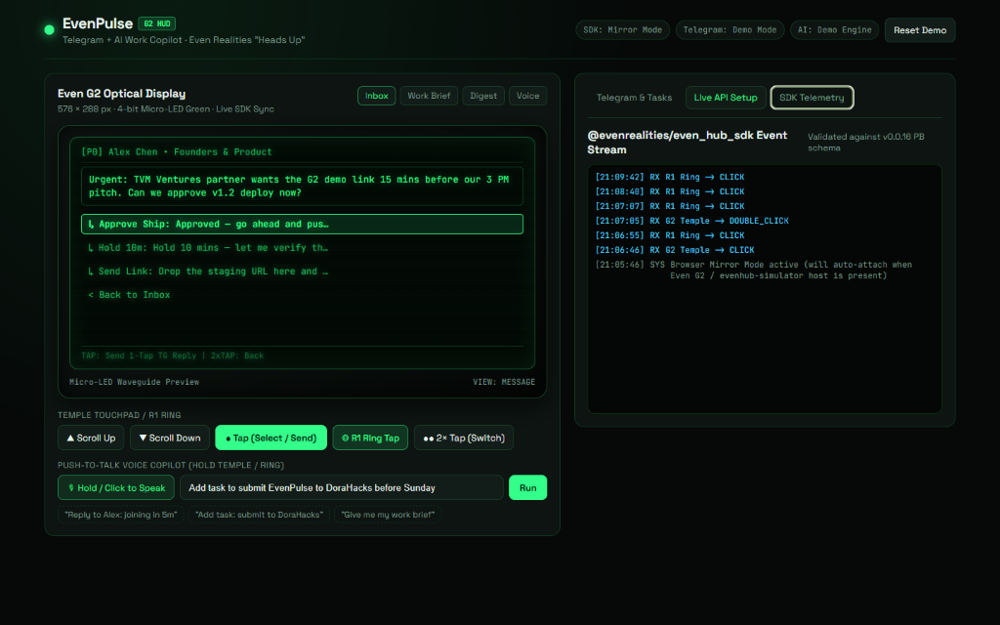

# EvenPulse

Telegram and work assistant for Even Realities G2 smart glasses and the R1 Ring.

Built for the Heads Up: Even Realities Hackathon on DoraHacks, targeting Track 01 (Messaging & News), Track 04 (AI Assistants & Work), and the Best Telegram Integration bounty ($1,000).



## What it does

EvenPulse reads incoming Telegram messages, scores urgency, and trims each message to fit the 576x288 Even G2 micro-LED display. From the glasses temple touchpad or the R1 Ring, you can open a message, send one of three AI-drafted replies back to Telegram, check off tasks in your work brief, or hold to speak a command.

### HUD layout and SDK integration

Each message gets tagged `P0`, `P1`, or `P2` and shortened to 44 characters or fewer. Text contrast uses the SDK `textColor` scale (header level `2`, body and list level `4`, footer level `1`) so notifications stay legible on the green display.

Scrolling on the glasses temple or R1 Ring highlights messages or tasks. One tap opens a message and displays three reply drafts; a second tap sends the selected draft through Telegram. Holding the touchpad or ring opens voice capture via `bridge.audioControl(true, AudioInputSource.Glasses)`, buffers 16 kHz mono PCM frames into WAV, and routes the transcript through the command parser (`reply_telegram`, `create_task`, `brief`, or `ask_ai`). In desktop browsers without glasses attached, the button falls back to Web Speech API.

All five views (`INBOX`, `MESSAGE`, `BRIEF`, `DIGEST`, `VOICE`) are built with `@evenrealities/even_hub_sdk` `v0.0.16` using `createStartUpPageContainer`, `rebuildPageContainer`, `MenuContainerProperty` for the OS contextual menu, `getDeviceInfo` / `onDeviceStatusChanged` for connection and battery telemetry, and `EventSourceType` to separate temple and R1 Ring taps.

### Two-way Telegram bot and calendar sync

When connected to a Telegram Bot token, the Express bridge runs long polling via `getUpdates`, registers slash commands with `setMyCommands`, and persists messages, tasks, and next-meeting prep in `data/state.json`. Sending `/start` pairs the chat ID automatically and returns inline buttons (`Work Brief`, `Push P0 Alert to G2`, `Open Tasks`). You can also send `/urgent <message>`, `/task <title>`, or `/brief` from Telegram.

Calendar integration parses any public `http` or `https` `.ics` feed after checking against local and private IP ranges, extracting the upcoming event title and countdown into the Work Brief.

## Architecture

```text
Telegram Bot API (getMe, getUpdates, sendMessage, setMyCommands + Inline Keyboards)
        |
        v
EvenPulse Bridge Server (Express + TypeScript, 127.0.0.1:3001)
  |-- AI Triage & Draft Engine (OpenRouter / Gemini / OpenAI + Rule-Based Fallback)
  |-- Voice Intent Router & G2 WAV STT
  |-- Public ICS Calendar Parser & State Store (data/state.json)
        |
        v  REST (/api/*)
EvenPulse WebView App (Vite + TypeScript, :5173)
  |-- @evenrealities/even_hub_sdk v0.0.16 (G2 Bridge + OS Contextual Menu)
  |-- Companion UI (576x288 Optical Mirror, Live API Setup, SDK Telemetry)
```

## Quick start

EvenPulse runs in demo mode with zero external keys required.

```bash
npm install
npm run dev
```

1. Open `http://localhost:5173` for the 576x288 G2 optical mirror and companion controls.
2. Run inside the official Even Hub simulator (requires `@evenrealities/evenhub-simulator`):
   ```bash
   npm run sim
   ```
3. Preview on physical Even G2 glasses via QR code:
   ```bash
   npm run qr
   ```
4. Build the distributable `.ehpk` package (`dist/` + `even-pulse.ehpk`):
   ```bash
   npm run pack
   ```

## Live Telegram, AI, and calendar setup

Configure credentials from the `Live API Setup` tab or by copying `.env.example` to `.env`:

1. Create a Telegram bot with `@BotFather` (`/newbot`), paste the token, and save settings. Send `/start` to your bot in Telegram to link your Chat ID automatically.
2. Optionally choose OpenRouter, Google Gemini, or OpenAI and add an API key for live triage, reply drafts, and voice audio transcription/routing. Leave the token or key input blank to keep existing server credentials untouched.
3. Paste any public `.ics` URL in the Calendar Sync section (or enter a custom meeting title and time) to update the G2 Work Brief.

All tokens and API keys stay in `server/` (bound to `127.0.0.1` by default; override with `HOST`) and are never included in the Vite frontend bundle or `even-pulse.ehpk`. Required WebView capabilities (`network`, `g2-microphone`) are declared in `app.json`.

## Tests and validation

```bash
npm test
npm run build
```

The Vitest suite verifies all five HUD views against `validateEvenHubPageContainer()` and 576x288 pixel bounds, rule-based and fenced-JSON AI triage, voice intent classification, public ICS URL checks and event parsing, Telegram token redaction, Express `/api/config` credential preservation, PCM-to-WAV encoding, and `EvenG2Controller` native and ring event handling.
